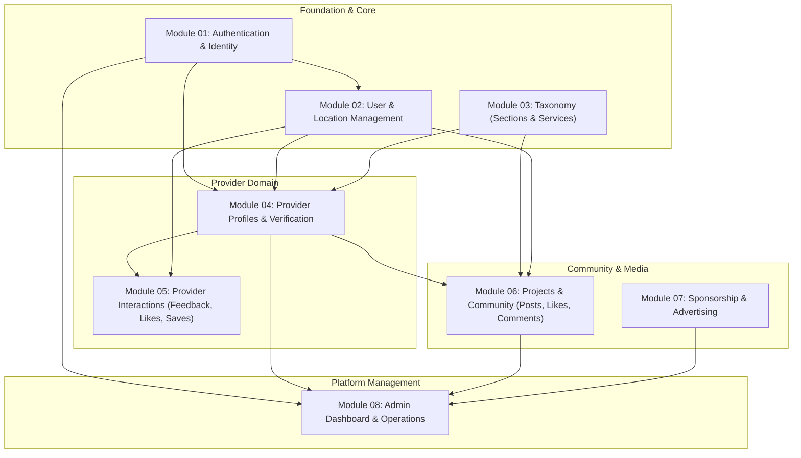

# Module Map and Dependency Matrix

Status: Phase 0 Discovery Complete  
Owner: Claude Code

---

## 1. Domain Capability Overview

Rather than treating each Eloquent model as an isolated silo, business capabilities in this application are organized into **8 cohesive business modules** based on actual runtime workflows, database foreign keys, API contracts, and user interactions.

---

## 2. Discovered Business Modules

### Module 01: Authentication & Identity
- **Primary Responsibility**: User registration, credential authentication, JWT token lifecycle, refresh token rotation, Google OAuth integration, password reset token dispatch and reset.
- **Models**: `User`, `RefreshToken`.
- **Controllers**: `UserController` (auth endpoints), `LoginController`, `Auth\GoogleController`.
- **Dependencies**: None (Root foundation).

### Module 02: User & Location Management
- **Primary Responsibility**: User profile maintenance, profile image upload, timezone configuration, multi-address / GPS geolocation management (`city`, `street`, `lat`, `long`).
- **Models**: `User`, `Location`.
- **Controllers**: `UserController` (profile endpoints), `LocationController`.
- **Dependencies**: Module 01 (Authentication & User entity).

### Module 03: Taxonomy (Sections & Services)
- **Primary Responsibility**: Two-level hierarchical catalog of service categories (Sections) and specific service offerings (Services). Serves both public API consumption and admin CRUD.
- **Models**: `Section`, `Service`.
- **Controllers**: `SectionController` (API), `ServiceController` (API), `admin\SectionController` (Web), `admin\ServiceController` (Web).
- **Livewire Components**: `SearchSection`, `SearchService`.
- **Dependencies**: None (Catalog foundation).

### Module 04: Provider Profiles & Verification
- **Primary Responsibility**: Provider onboarding (`nationalId`, SSN document uploads, live photos, company information, social links), admin review workflows (`waiting`, `accepted`, `updated`, `rejected`), provider availability status (`available`, `busy`), portfolio showcase (`EmployeeWork` with up to 5 images/videos), and administrative notification messages (`Contact`).
- **Models**: `Employee`, `EmployeeWork`, `Contact`.
- **Controllers**: `EmployeeController` (API), `EmployeeWorkController` (API), `ContactController` (API), `AdminController` (API status toggles), `admin\EmployeeController` (Web).
- **Livewire Components**: `WaitingEmployee`, `AcceptEmployee`, `UpdateEmployee`.
- **Dependencies**: Module 01 (User), Module 02 (Location), Module 03 (Section, Service).

### Module 05: Provider Interactions & Engagement
- **Primary Responsibility**: User-to-provider interactions: submission and display of star ratings/reviews (`Feedback`), provider bookmarking/saving (`Favourite`), and provider profile likes (`Like`).
- **Models**: `Feedback`, `Like`, `Favourite`.
- **Controllers**: `FeedbackController`, `LikeController`, `FavouriteController`.
- **Dependencies**: Module 01 (User as reviewer/liker), Module 04 (Employee as recipient).

### Module 06: Projects & Community
- **Primary Responsibility**: Community feed where users post project requests or showcase works tagged with a Section, Service, and City. Includes community comments, comment editing, project likes, view tracking, and author ownership authorization.
- **Models**: `Project`, `ProjectLike`, `Comment`.
- **Controllers**: `ProjectController` (API), `admin\ProjectController` (Web).
- **Livewire Components**: `SearchProject`.
- **Dependencies**: Module 01 (User/Author), Module 03 (Section, Service), Module 04 (Employee context for category matching).

### Module 07: Sponsorship & Advertising
- **Primary Responsibility**: Commercial sponsor ads management (banners, title, expiration date, active/expired status) for display on client applications and web admin management.
- **Models**: `Sponser`.
- **Controllers**: `SponserController` (API), `admin\SponserController` (Web).
- **Livewire Components**: `SearchSponser`.
- **Dependencies**: Standalone (Independent module).

### Module 08: Admin Dashboard & Platform Operations
- **Primary Responsibility**: Administrative KPI dashboard (aggregate counts of users, waiting/accepted/updated employees, categories, sponsors), web session authentication, admin account creation, and user management.
- **Models**: Aggregates from all modules.
- **Controllers**: `admin\AdminController`.
- **Livewire Components**: `SearchUser`.
- **Dependencies**: Modules 01, 03, 04, 07.

---

## 3. Module Dependency Matrix

| Module | 01 Auth | 02 User/Loc | 03 Taxonomy | 04 Provider | 05 Interact | 06 Projects | 07 Sponsor | 08 Admin |
|---|:---:|:---:|:---:|:---:|:---:|:---:|:---:|:---:|
| **01 Auth** | — | | | | | | | |
| **02 User/Loc** | X | — | | | | | | |
| **03 Taxonomy** | | | — | | | | | |
| **04 Provider** | X | X | X | — | | | | |
| **05 Interact** | X | | | X | — | | | |
| **06 Projects** | X | | X | X | | — | | |
| **07 Sponsor** | | | | | | | — | |
| **08 Admin** | X | X | X | X | | X | X | — |

*Note: "X" in row M and column C indicates that Module M depends on Module C.*

---

## 4. Recommended Implementation Order

To guarantee backward compatibility and eliminate circular refactoring blockers, the modules must be refactored strictly in topological order:

1. **Step 1: Module 01 — Authentication & Identity** (Foundational identity, JWT guards, password reset).
2. **Step 2: Module 02 — User & Location Management** (User profile, multi-location geolocation).
3. **Step 3: Module 03 — Taxonomy (Sections & Services)** (Independent category catalog, zero upward dependencies).
4. **Step 4: Module 04 — Provider Profiles & Verification** (Depends on User, Location, Taxonomy; unlocks core business logic).
5. **Step 5: Module 05 — Provider Interactions & Engagement** (Depends on Provider and User).
6. **Step 6: Module 06 — Projects & Community** (Depends on User, Taxonomy, Provider).
7. **Step 7: Module 07 — Sponsorship & Advertising** (Self-contained commercial banners).
8. **Step 8: Module 08 — Admin Dashboard & Platform Operations** (Consolidates cross-module metrics and administrative security).
